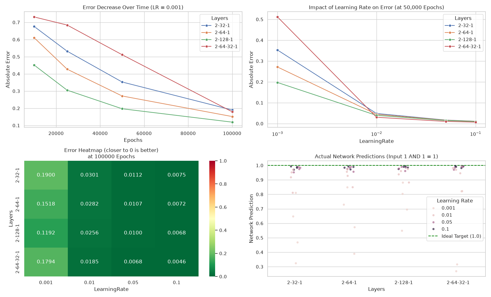

# Neuro
Минималистичная реализация многослойного перцептрона (MLP) с обучением методом обратного распространения ошибки (Backpropagation) на .NET 10 (C#) с инструментами автоматизации и анализа на Python.

## Структура проекта

* **`Neuro.Functions/`** — функции активации (интерфейс `IFunction`, реализация `Sigmoid`).
* **`Neuro.Network/`** — архитектура нейросети (слои, нейроны, прям. проход и Backpropagation).
* **`Neuro.Perceptron/`** — консольное приложение для обучения сети на логической операции `AND`.
* **`collect.py`** — Python-скрипт для автоматического перебора гиперпараметров (Grid Search).
* **`analyze.py`** — скрипт для визуализации результатов (Seaborn / Matplotlib).
* **`results/`** — директория с сохраненными результатами экспериментов.

## Быстрый запуск

### 1. Обучение сети (C#)

```bash
dotnet run --project Neuro.Perceptron -c Release -- -e 50000 -r 0.01 -l 2,64,1 -f
```

**Параметры:**
* `-e, --epochs` — количество эпох.
* `-r, --learningRate` — скорость обучения (learning rate).
* `-l, --layers` — конфигурация слоев (например, `2,64,1`: 2 входа, 64 нейрона в скрытом слое, 1 выход).
* `-f, --writeToFile` — сохранить результаты обучения в папку `results/`.

### 2. Запуск перебора параметров и анализа (Python)



```bash
# Автоматический запуск экспериментов с разной конфигурацией
python3 collect.py

# Генерация графиков и анализ ошибок
python3 analyze.py
```

## Лицензия

[GNU GPL v3](LICENSE)
